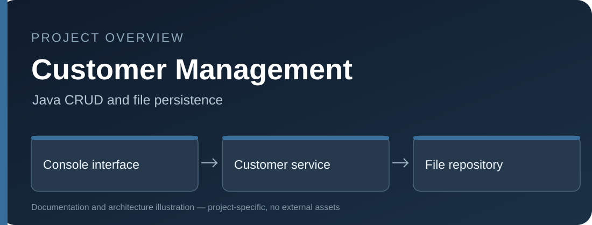

# Customer Management — Core Java



A Java 17 console application demonstrating a layered architecture, CRUD operations, validation, local persistence and JUnit 5 testing.

## Features
- Create, read, update, list and delete customers.
- Validate name, email and a 10-digit identifier.
- Prevent duplicate identifiers and email addresses.
- Separate CLI, service, validation and repository layers.
- Persist data to a local file with safe file replacement.
- Automated tests in GitHub Actions.

## Run
```bash
mvn clean verify
java -cp target/classes com.mohaddesehakmali.customers.CustomerManagementApplication
```

Set `-Dcustomer.data.file=/path/to/customers.db` to change the storage path. The default file is `data/customers.db`.

## Security and limitations
The local storage is not encrypted and supports only a single writing process. Do not store real sensitive personal information in this learning project.
